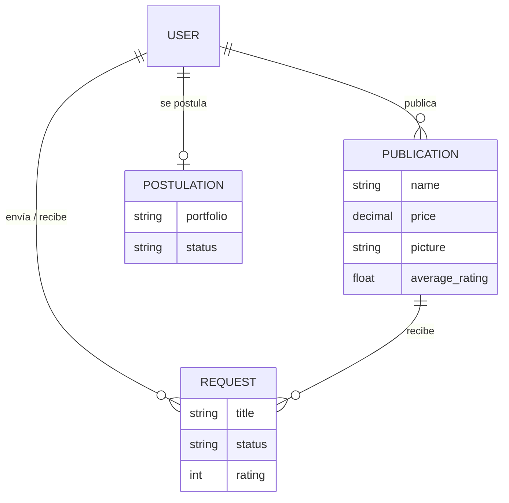

# 🎨 Artlink

Marketplace donde artistas publican su obra y reciben encargos. Los clientes exploran las publicaciones, piden una obra por encargo con una imagen de referencia y, al terminar, califican el trabajo.

Hecho con **Ruby on Rails 8**.

## Qué hace

- **Publicaciones**: los artistas suben obras con nombre, descripción, precio e imagen. La página principal las muestra a todos.
- **Solicitudes de encargo**: un cliente pide una obra sobre una publicación, adjunta una imagen de referencia y un contacto. El artista ve las solicitudes recibidas y el cliente las enviadas, cada una con su estado.
- **Calificaciones**: el cliente puntúa cada encargo de 1 a 5 y la publicación muestra el promedio.
- **Postulaciones para ser artista**: cualquier usuario puede postularse con su portafolio. Un administrador revisa las postulaciones y, al aceptar una, el usuario pasa a tener permisos de artista.
- **Perfiles**: biografía y enlaces a redes (Facebook, X, Instagram).

### Roles

| Rol | Puede |
|---|---|
| Usuario | Ver publicaciones, pedir encargos, calificar y postularse como artista |
| Artista | Todo lo anterior, más crear publicaciones y recibir encargos |
| Administrador | Revisar y aceptar o rechazar postulaciones |

### Seguridad de cuentas

- Autenticación con **Devise**, confirmación de correo y recuperación de contraseña.
- **Autenticación en dos pasos (TOTP)** con `devise-two-factor`.
- Contraseñas con al menos un número y un carácter especial.
- Análisis estático con **Brakeman**.

## Stack

| | |
|---|---|
| Backend | Ruby 3.3.5 · Rails 8 · SQLite |
| Frontend | Hotwire (Turbo + Stimulus) · Importmap · Bootstrap |
| Archivos | CarrierWave |
| Colas y caché | Solid Queue · Solid Cache · Solid Cable |
| Tests | RSpec · FactoryBot · Shoulda Matchers |
| Despliegue | Docker · Kamal |

## Modelo de datos



## Correr en local

Requisitos: Ruby 3.3.5 y Bundler.

```bash
git clone https://github.com/latmedina/Artlink.git
cd Artlink
bin/setup          # instala gemas y prepara la base de datos
bin/dev            # levanta el servidor en http://localhost:3000
```

La autenticación en dos pasos necesita una clave de cifrado en el entorno:

```bash
export DEVISE_OTP_SECRET_ENCRYPTION_KEY=$(bin/rails secret)
```

## Tests

```bash
bundle exec rspec
```

Las pruebas cubren los modelos (`User`, `Publication`, `Request`) y las vistas de publicaciones.
